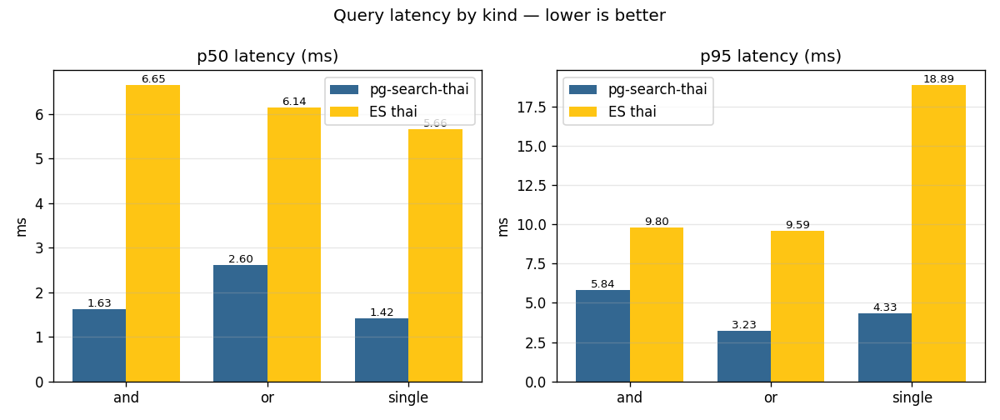

pg-search-thai
============================

pg-search-thai is full text search _PostgreSQL_ extension for Thai Language.

Its main purpose is:

To enable PostgreSQL Full Text Search in Thai language (Due to Thai Language does not use spaces to separate words)

## Performance

Benchmarked against **Elasticsearch 8.15 with the built-in `thai` analyzer** on
100,000 Thai Wikipedia articles, single Docker host, warm cache:



| Metric | pg-search-thai | ES (thai analyzer) |
|---|---|---|
| Single-term query (p50 / p95) | **1.4 ms / 4.3 ms** | 5.7 ms / 18.9 ms |
| Boolean AND (p50 / p95) | **1.6 ms / 5.8 ms** | 6.7 ms / 9.8 ms |
| Boolean OR (p50 / p95) | **2.6 ms / 3.2 ms** | 6.1 ms / 9.6 ms |
| Index size | **105 MB** | 427 MB |
| Write → searchable lag | 0 ms (transactional) | ~1 s (refresh interval) |

Full reproducible harness, methodology, and caveats: see [`bench/BENCHMARKS.md`](bench/BENCHMARKS.md)
and [`bench/README.md`](bench/README.md).

## Installation

### Quick start with Docker

Spins up Postgres 18 with `thai_parser` pre-built and the extension auto-created:

    git clone https://github.com/zdk/pg-search-thai.git
    cd pg-search-thai
    docker compose up -d

Connect with `psql` (password: `testpass`):

    psql -h localhost -U testuser -d testdb \
      -c "SELECT * FROM ts_parse('thai_parser', 'ต้มยำกุ้ง');"

### From source

Install `libthai` and the Postgres build headers via your package manager:

    # Debian / Ubuntu
    sudo apt install -y build-essential libthai-dev postgresql-server-dev-all

    # macOS (Homebrew)
    brew install libthai libdatrie

Then build and install the extension:

    git clone https://github.com/zdk/pg-search-thai.git
    cd pg-search-thai
    make
    sudo make install

To install only the parser (without the bundled hunspell dictionary files):

    cd thai_parser && make && sudo make install

## Usage

Enable the extension (UTF-8 databases only):

    CREATE EXTENSION thai_parser;

This installs the `thai_parser` parser and a text search configuration named `thaicfg`.

### Quick tour

Four primitives: `ts_parse` (debug), `to_tsvector` (index), `to_tsquery` (query), `@@` (match).

**1. Tokenize.** libthai finds word boundaries even without spaces:

```
SELECT * FROM ts_parse('thai_parser', 'ต้มยำกุ้ง Thai shrimp soup');
 tokid | token
-------+--------
    97 | ต้มยำ
    97 | กุ้ง
    99 |
    98 | Thai
    99 |
    98 | shrimp
(...)
-- tokid 97 = Thai word (a), 98 = English word or number (b), 99 = space (c)
```

These token types are this parser's own. The standard parser's names such as
`asciiword` do not exist here: `SELECT * FROM ts_token_type('thai_parser')`
lists `a`, `b` and `c`.

**2. Build a `tsvector`.** `thaicfg` indexes Thai words and, since 1.1.0,
English words and numbers too, lowercased by the `simple` dictionary. Thai text
routinely mixes in English (street names, brands, `CCTV`, `BTS`), so both are
searchable:

```
SELECT to_tsvector('thaicfg', 'ต้มยำกุ้ง Thai shrimp soup');
                 to_tsvector
----------------------------------------------
 'shrimp':4 'soup':5 'thai':3 'กุ้ง':2 'ต้มยำ':1
```

Up to 1.0.0, `thaicfg` mapped only Thai words, so English was parsed and then
dropped. To upgrade a database created with 1.0.0, see
[Upgrading from 1.0.0](#upgrading-from-100).

One quirk: punctuation stays attached to an English token, so `(CCTV)` is
indexed as `'(cctv)'` and `BTS.` as `'bts.'`, and a search for `cctv` or `bts`
misses them. If your text has such punctuation, strip ASCII punctuation from
both the text and the query first, for example with
``regexp_replace(t, '[!-/:-@\[-`{-~]', ' ', 'g')``. Do not use
`[^[:alnum:]]` for this: Thai vowels and tone marks are not `[:alnum:]`, and
removing them breaks Thai words apart.

**3. Match.** `@@` returns boolean:

```
SELECT to_tsvector('thaicfg', 'ส้มตำกับข้าวเหนียว')
    @@ to_tsquery('thaicfg', 'ส้มตำ');
 ?column?
----------
 t
```

**4. Boolean operators** — `&` and, `|` or, `!` not, `()` group. Thai words written together still match:

```
-- "ข้าวเหนียวส้มตำ" with no space between the two words:
SELECT to_tsvector('thaicfg', 'ข้าวเหนียวส้มตำไก่ย่าง')
    @@ to_tsquery('thaicfg', 'ข้าวเหนียว & ส้มตำ');
 ?column?
----------
 t
```

### Searching a real table

The shape you'll use in an app — store text, keep a `tsvector` in sync, GIN-index it, query through the index:

```sql
CREATE TABLE articles (
    id     SERIAL PRIMARY KEY,
    title  TEXT NOT NULL,
    body   TEXT NOT NULL,
    search tsvector GENERATED ALWAYS AS
        (to_tsvector('thaicfg', title || ' ' || body)) STORED
);
CREATE INDEX articles_search_idx ON articles USING GIN (search);

INSERT INTO articles (title, body) VALUES
    ('ส้มตำไทย',  'ส้มตำเป็นอาหารพื้นบ้านของภาคอีสาน'),
    ('ต้มยำกุ้ง', 'ต้มยำกุ้งเป็นซุปรสจัดที่มีชื่อเสียงระดับโลก'),
    ('ผัดไทย',   'ผัดไทยเป็นอาหารเส้นที่นิยมไปทั่วประเทศ');

SELECT id, title, ts_rank(search, q) AS rank
FROM   articles, to_tsquery('thaicfg', 'ส้มตำ') q
WHERE  search @@ q
ORDER  BY rank DESC;
 id |  title   |  rank
----+----------+--------
  1 | ส้มตำไทย |  0.076
```

### From your app

The query is plain SQL; only the parameter-binding syntax differs by client. Same `articles` table as above:

**Node.js** ([`pg`](https://node-postgres.com))

```js
import { Client } from 'pg';

const db = new Client({ connectionString: process.env.DATABASE_URL });
await db.connect();

const { rows } = await db.query(
  `SELECT id, title, ts_rank(search, q) AS rank
   FROM   articles, to_tsquery('thaicfg', $1) q
   WHERE  search @@ q
   ORDER  BY rank DESC`,
  ['ส้มตำ'],
);
console.log(rows);
```

**Python** ([`psycopg`](https://www.psycopg.org/psycopg3/) v3)

```python
import os, psycopg

with psycopg.connect(os.environ["DATABASE_URL"]) as conn, conn.cursor() as cur:
    cur.execute("""
        SELECT id, title, ts_rank(search, q) AS rank
        FROM   articles, to_tsquery('thaicfg', %s) q
        WHERE  search @@ q
        ORDER  BY rank DESC
    """, ("ส้มตำ",))
    for row in cur.fetchall():
        print(row)
```

**Go** ([`pgx`](https://github.com/jackc/pgx) v5)

```go
ctx := context.Background()
conn, _ := pgx.Connect(ctx, os.Getenv("DATABASE_URL"))
defer conn.Close(ctx)

rows, _ := conn.Query(ctx, `
    SELECT id, title, ts_rank(search, q) AS rank
    FROM   articles, to_tsquery('thaicfg', $1) q
    WHERE  search @@ q
    ORDER  BY rank DESC`, "ส้มตำ")
defer rows.Close()

for rows.Next() {
    var id int; var title string; var rank float32
    rows.Scan(&id, &title, &rank)
    fmt.Println(id, title, rank)
}
```

> Pass user input as a parameter (`$1` / `%s`), not by string-concatenation, so it goes through `to_tsquery` safely.

### Advanced: hunspell dictionary

For richer normalization, use the bundled Thai hunspell files. `make install`
(and the Docker image) puts them in `$(pg_config --sharedir)/tsearch_data/` as
`th_th.dict` and `th_th.affix`. The names must be lowercase: PostgreSQL only
opens text search files named with lowercase letters, digits and `_`.

    CREATE TEXT SEARCH DICTIONARY thai_hunspell (
        TEMPLATE  = ispell,
        DictFile  = th_th,
        AffFile   = th_th,
        StopWords = english
    );
    SELECT ts_lexize('thai_hunspell', 'ทดสอบ');     -- {ทดสอบ}

    -- Your own configuration, copied from thaicfg:
    CREATE TEXT SEARCH CONFIGURATION thaicfg_hunspell (COPY = thaicfg);
    ALTER TEXT SEARCH CONFIGURATION thaicfg_hunspell
        ALTER MAPPING FOR a WITH thai_hunspell, simple;
    SELECT to_tsvector('thaicfg_hunspell', 'ทดสอบการตัดคำ');

Three details matter here:

- `thaicfg` already maps Thai words (`a`), so use `ALTER MAPPING`. A second
  `ADD MAPPING FOR a` fails with a duplicate key error.
- Put `thai_hunspell` **before** `simple`. PostgreSQL tries the dictionaries in
  order and stops at the first one that recognizes the word. `simple`
  recognizes every word, so anything after it is never consulted.
- Change a copy, not `thaicfg` itself. `thaicfg` belongs to the extension, and
  `pg_dump` does not dump changes made to an extension's own objects, so a
  mapping altered on `thaicfg` is silently gone after a dump and restore. A
  configuration you created yourself is dumped normally.

Run `\dFd` in `psql` to confirm the dictionary is installed.

## Upgrading from 1.0.0

After installing the new version, run this in **each database** that uses the
extension (extensions are per database):

```sql
ALTER EXTENSION thai_parser UPDATE;
SELECT extversion FROM pg_extension WHERE extname = 'thai_parser';   -- 1.1.0
```

It adds the English mapping to `thaicfg`. It is safe on a database that already
added `ADD MAPPING FOR b` by hand; it checks first.

**Then recompute stored tsvectors.** The update changes how new text is
indexed, not what is already stored. It matters for two reasons:

- Rows indexed under 1.0.0 do not contain their English words.
- If you had mapped English yourself, rows indexed by a library older than this
  release may hold damaged English words. An English word or number at the very
  end of a text used to absorb stray bytes (`soup` stored as `soupcctv`), so a
  search for the real word misses the row. That was a bug in the C code, fixed
  in the same release; `ALTER EXTENSION` does not repair data it produced.

For a generated column (PostgreSQL 17+; this rewrites the table and locks it
while it runs):

```sql
ALTER TABLE articles ALTER COLUMN search SET EXPRESSION AS
    (to_tsvector('thaicfg', title || ' ' || body));
ANALYZE articles;
```

For a column maintained by a trigger or by your application, rewrite it with an
`UPDATE`.

### Why the English mapping is part of the extension

`thaicfg` belongs to the extension, and `pg_dump` does not dump changes made to
an extension's own objects. A dump contains only `CREATE EXTENSION
thai_parser`, and the restore creates `thaicfg` exactly as the installed
version ships it. So under 1.0.0, an English mapping added by hand disappeared
on every dump and restore, with no error: Thai searches kept working and English
searches quietly found nothing. Shipping the mapping in the extension script
means `CREATE EXTENSION` recreates it.

The dump does not record the extension version either. A restore gets the
default version of the server it is restored into, so check it afterwards:

```sql
SELECT extversion FROM pg_extension WHERE extname = 'thai_parser';
SELECT to_tsvector('thaicfg', 'กล้อง CCTV');                 -- includes 'cctv'
```

If you customize `thaicfg` further, customize a copy instead
(`CREATE TEXT SEARCH CONFIGURATION my_thai (COPY = thaicfg)`); a configuration
you created is dumped normally.

## Bugs Report and Contributing

GitHub issue tracker and pull requests are welcome.

_pg-search-thai_ is released under the GNU General Public License (GPLv2).
Refer to License [FAQ](http://www.gnu.org/licenses/old-licenses/gpl-2.0-faq.html) for more information.
